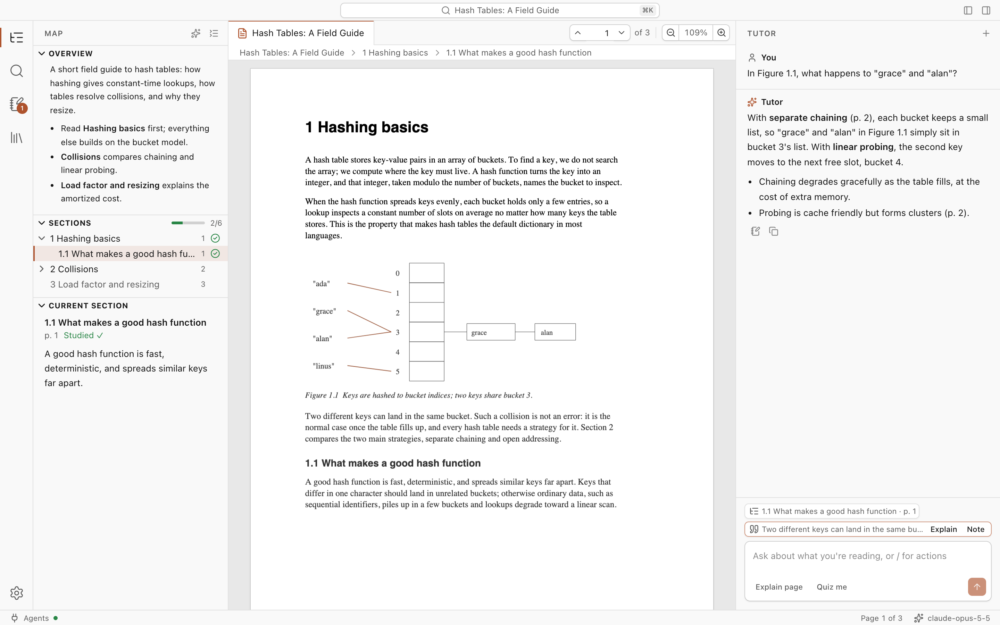

<p align="center">
  <picture>
    <source media="(prefers-color-scheme: dark)" srcset=".github/assets/screenshot-dark.png" />
    
  </picture>
</p>

<h1 align="center">Anagnost</h1>

<p align="center">
  The PDF reader your coding agent can see: a local-first macOS app for studying long technical documents.<br/>
  It maps a PDF into sections, answers questions about the page you're on with <a href="https://www.anthropic.com/claude">Claude</a> or <a href="https://cursor.com">Cursor</a>, and shares your reading session with Claude Code or Cursor over <a href="https://modelcontextprotocol.io">MCP</a>.
</p>

<p align="center">
  <a href="https://github.com/AlexShavkuta/anagnost"></a>
  <a href="https://github.com/AlexShavkuta/anagnost/actions"></a>
</p>

<p align="center">
  <a href="#quick-start">Get Started</a> ·
  <a href="https://github.com/AlexShavkuta/anagnost/releases/latest">Download</a> ·
  <a href="docs/guide.md">Guide</a> ·
  <a href="docs/development.md">Development</a>
</p>

## Features

- 🗺️ **Document map** — splits a PDF into sections from its bookmarks, with a summary, key concepts and review questions for each, plus an overview with a suggested reading path
- 🧠 **Tutor that knows your page** — answers are grounded in the section you're reading and cite pages; select text to have it explained or saved as a note
- 🤝 **Shared with your agent** — while it's open, Claude Code or Cursor can read the document, see your page and selection, move the viewer, and write to the map and notes
- 🔑 **Bring your own key** — use your Anthropic API key or your Cursor plan; see the estimated cost before building a map and stop it at any time
- 🔍 **Scanned PDFs, offline** — pages without text are recognized on your Mac with [Qianfan-OCR](https://huggingface.co/baidu/Qianfan-OCR); nothing leaves the machine
- ✅ **Study progress** — tick sections off as studied, quiz yourself, and pick up where you left off: the last PDF reopens at the page you were on
- ⚡ **Made for long documents** — a VS Code-style window built with Tauri and pdf.js, with search, keyboard shortcuts and a ⌘K palette that jumps to any section
- 🚀 **Updates itself** — new releases show up in the corner of the window and install with one click

## Quick Start

Download the latest `Anagnost-*-macos-universal.zip` from [Releases](https://github.com/AlexShavkuta/anagnost/releases/latest), unzip it and move **Anagnost** to Applications. The app isn't notarized yet, so if macOS blocks it the first time, allow it under System Settings → Privacy & Security, or run `xattr -dr com.apple.quarantine /Applications/Anagnost.app`. Then add an Anthropic or Cursor API key in Settings.

Or build it from source (needs Xcode Command Line Tools, Rust and Node.js):

```bash
git clone https://github.com/AlexShavkuta/anagnost.git
cd anagnost
npm run install-app
```

The [guide](docs/guide.md) covers keys and models, map costs, text recognition, connecting Claude Code or Cursor, and where your data lives.

## Community

The Anagnost community lives on [GitHub](https://github.com/AlexShavkuta/anagnost), where you can ask questions, share ideas, and show what you've built.

## Contributing

Contributions are welcome. Open an [issue](https://github.com/AlexShavkuta/anagnost/issues) to discuss a change before sending a pull request. [docs/development.md](docs/development.md) explains how to run the app from source, how the code is laid out, and how releases work.

## Security

Please do not open public issues for security vulnerabilities. Report them privately through [GitHub Security Advisories](https://github.com/AlexShavkuta/anagnost/security/advisories/new).

## License

[MIT](LICENSE)

## Contributors

[](https://github.com/AlexShavkuta/anagnost/graphs/contributors)

> Made with [contrib.rocks](https://contrib.rocks)

## Star History

<a href="https://www.star-history.com/?repos=AlexShavkuta%2Fanagnost&type=date&legend=top-left">
 <picture>
   <source media="(prefers-color-scheme: dark)" srcset="https://api.star-history.com/chart?repos=AlexShavkuta/anagnost&type=date&theme=dark&legend=top-left" />
   <source media="(prefers-color-scheme: light)" srcset="https://api.star-history.com/chart?repos=AlexShavkuta/anagnost&type=date&legend=top-left" />
   
 </picture>
</a>
